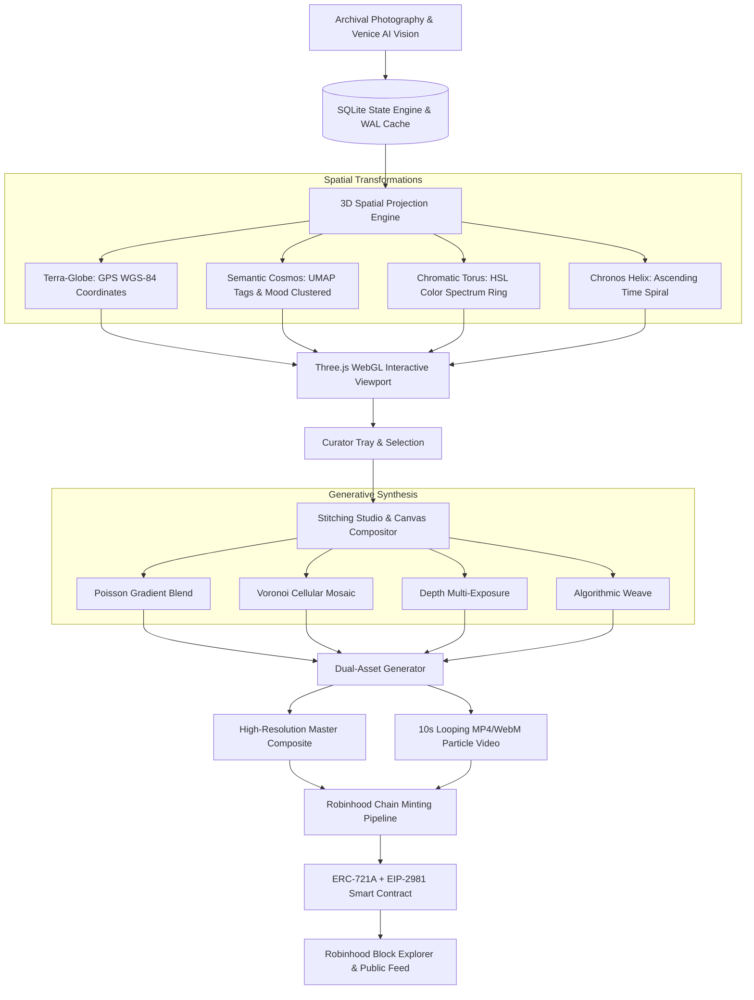

# 🌌 AetherSphere

[](https://robinhoodchain.blockscout.com)
[-FF007F?style=for-the-badge)](https://rpc.mainnet.chain.robinhood.com)
[](https://threejs.org/)
[](https://fastapi.tiangolo.com)
[](https://github.com/maximusmaximus/flickrtag)
[](LICENSE)

> **AetherSphere** is an interactive 3D spatial photogrammetry universe, generative composition studio, and dual-asset NFT minting platform built on the **Robinhood Chain** (Arbitrum Orbit / Nitro L2, Chain ID: `4663`).
> 
> Explore archives of historical photography mapped across 4-dimensional spatial projections, craft multi-exposure composite artworks via algorithmic canvas shaders, generate synchronized 10-second cinematic video loops, and mint them into curated supply-capped category pools with complete on-chain provenance.

---

## 🧬 Upstream Lineage & Ecosystem: `flickrtag`

AetherSphere operates in tandem with its sister project, [**`maximusmaximus/flickrtag`**](https://github.com/maximusmaximus/flickrtag) — the automated Flickr photo autotagging and vision curation engine.

```text
┌─────────────────────────────────────────────────────────────┐
│                 MAXIMUSMAXIMUS / FLICKRTAG                  │
│  Flickr API ──> Venice AI Vision ──> AI Tags & Descriptions │
│  Reverse Geocoding (Nominatim) ──> SQLite state.db          │
└──────────────────────────────┬──────────────────────────────┘
                               │
                               ▼
┌─────────────────────────────────────────────────────────────┐
│                MAXIMUSMAXIMUS / AETHERSPHERE                │
│  4D Coordinate Transformations (Globe, Cosmos, Torus, Helix)│
│  Three.js WebGL Interactive Viewport                        │
│  Generative Canvas Stitching Studio (Poisson, Voronoi)      │
│  10-Second Looping Video Synthesis                          │
│  Robinhood Chain (ID: 4663) ERC-721A Dual-Asset NFT Minting │
└─────────────────────────────────────────────────────────────┘
```

### How They Connect:
- **Direct Bridge**: When running on a machine with `flickr-autotagger` configured, AetherSphere reads directly from `~/.flickr-autotagger/state.db`, providing instant 3D exploration and composition for all **15,769 Flickr photographs**, **314,294 Venice AI vision tags**, and **902 GPS geocoded coordinates**.
- **Autonomous Fallback**: When cloned on standalone environments without `flickrtag` present, AetherSphere automatically bootstraps a self-contained sample archive (`sample_archive.db`) so all 3D viewports, canvas composition tools, and Robinhood Chain minting features work immediately with zero dependencies.
- **Learn More**: Visit [**maximusmaximus/flickrtag**](https://github.com/maximusmaximus/flickrtag) for Flickr authentication, CLI batch processing, Venice AI tag generation, and photoset synchronization.

---

## ⚡ Architecture Overview



---

## 🚀 Key Platform Features

### 1. 3D Spatial Universe (Three.js WebGL)
- **Terra-Globe**: 3D interactive Earth globe pinning exact GPS coordinates across cities and wilderness regions.
- **Semantic Cosmos**: 3D starfield cluster space positioned by AI tags, scene types, and ambient mood vectors.
- **Chromatic Torus**: Geometric color spectrum donut wheel sorted by dominant HSV/RGB palette hexes.
- **Chronos Helix**: Ascending temporal time-spiral winding through chronological capture dates.
- **Interactive Raycasting**: Instant HUD telemetry displaying photo dimensions, camera parameters, Venice AI descriptions, and confidence tags.

### 2. Canvas Stitching Studio & Compositor
- **4 Algorithmic Blend Modes**:
  - *Poisson Gradient Blending*: Seamless edge relaxation and harmonic tone equalization.
  - *Voronoi Cellular Mosaic*: Algorithmic partitioning with organic tessellation.
  - *Depth Multi-Exposure*: Screen, overlay, and color-dodge layering with depth-mask simulation.
  - *Algorithmic Weave*: Interlocking horizontal and vertical photo ribbon matrix.
- **Real-Time Shaders**: Adjustable seam feathering, chromatic aberration, vignette decay, and analog film grain noise.

### 3. Dual-Asset Generative Synthesis
- **Master Composite Artwork**: Exported at up to 4K resolution directly from the client canvas.
- **10-Second Looping Video**: Client-side hardware-accelerated video synthesis rendering a cinematic Ken Burns zoom oscillation with ambient floating cosmic particles.
- **Deep Provenance Record**: JSON-LD and OpenSea-compliant metadata preserving contributing photo IDs, original capture dates, geographic centroids, and tag cocktails.

### 4. Robinhood Chain (Arbitrum Orbit L2) Integration
- **Direct RPC Connectivity**: Real-time block synchronization and gas tracker querying `https://rpc.mainnet.chain.robinhood.com`.
- **EIP-1193 Web3 Injected Wallet Switcher**: Automatic network detection with programmatic `wallet_switchEthereumChain` and `wallet_addEthereumChain` fallback for MetaMask, Coinbase Wallet, and Rabby.
- **Smart Contract (`RobinhoodCompositeNFT.sol`)**:
  - ERC-721A batch gas optimizations.
  - EIP-2981 standardized secondary market royalties (500 bps = 5%).
  - Multi-category pool allocation with per-wallet minting safeguards.

### 5. Operator Admin Console
- **Pool Management**: Create and configure custom pool categories, floor prices, maximum supply, and per-wallet limits.
- **State Telemetry**: Live watchdog tracking total archive photos, vision analysis completion rate, and treasury revenue.
- **Live Mints Showcase**: Public real-time feed with hover video playback, lineage inspection, and Twitter/Telegram share gates.

---

## 📐 Spatial Mathematics & Projections

### 1. Terra-Globe (Spherical Earth Coordinates)
Given latitude $\phi \in [-90^\circ, 90^\circ]$ and longitude $\lambda \in [-180^\circ, 180^\circ]$, Cartesian coordinates on a sphere of radius $R$:
$$x = R \cos(\phi) \sin(\lambda)$$
$$y = R \sin(\phi)$$
$$z = R \cos(\phi) \cos(\lambda)$$

### 2. Chromatic Torus (Color Spectrum Donut)
Given primary color hue $\theta \in [0, 2\pi)$, major torus radius $R$, minor radius $r$, and secondary harmonic angle $\psi$:
$$x = (R + r \cos \psi) \cos \theta$$
$$y = r \sin \psi$$
$$z = (R + r \cos \psi) \sin \theta$$

### 3. Chronos Helix (Temporal Spiral)
Given normalized timestamp $\tau \in [0, 1]$, spiral pitch $H$, and angular revolutions $N$:
$$x = R \cos(2\pi N \tau)$$
$$y = H \cdot \left(\tau - \frac{1}{2}\right)$$
$$z = R \sin(2\pi N \tau)$$

---

## ⛓️ Robinhood Chain EVM Specification

| Parameter | Mainnet Setting |
|---|---|
| **Network Name** | Robinhood Chain |
| **Chain ID** | `4663` (`0x1237`) |
| **Native Gas Token** | `ETH` |
| **Decimals** | 18 |
| **Settlement Layer** | Ethereum Mainnet via Arbitrum Orbit (Nitro Stack) |
| **JSON-RPC Endpoint** | `https://rpc.mainnet.chain.robinhood.com` |
| **Block Explorer** | [https://robinhoodchain.blockscout.com](https://robinhoodchain.blockscout.com) |

---

## ⚡ Quick Start

### Prerequisites
- Python 3.10+
- Modern Web Browser with WebGL support

### Installation
```bash
# Clone the repository
git clone https://github.com/maximusmaximus/aethersphere.git
cd aethersphere

# Create virtual environment
python3 -m venv .venv
source .venv/bin/activate  # On Windows: .venv\Scripts\activate

# Install dependencies
pip install -r requirements.txt
```

### Launch the Application
```bash
# Direct Python execution:
python run_server.py --port 8000

# Or using the launcher scripts:
./start_server.sh         # Linux / macOS / WSL
start_server.bat          # Windows Command Prompt
```

Open **[http://localhost:8000](http://localhost:8000)** in your browser.

---

## 🧪 Testing & Verification

Run the full End-to-End API, Robinhood Chain, and unit test suites:

```bash
pytest -v
```

All tests execute against live Robinhood Chain JSON-RPC endpoints, SQLite WAL database engines, and FastAPI test clients.

---

## 📁 Repository Structure

```text
aethersphere/
├── backend/
│   ├── database.py         # SQLite WAL engine, queries & auto-seeding sample fallback
│   ├── main.py             # FastAPI REST API, modern lifespan handlers & static serving
│   ├── robinhood_chain.py  # Live Robinhood JSON-RPC client (Chain ID: 4663)
│   ├── seed_demo_mint.py   # Genesis demo composition and mint bootstrap
│   └── spatial_math.py     # 3D coordinate mathematics (Globe, Cosmos, Torus, Helix)
├── contracts/
│   ├── RobinhoodCompositeNFT.sol  # ERC-721A + EIP-2981 multi-pool smart contract
│   └── deploy.js                  # Deployment script for Robinhood Chain
├── static/
│   ├── app.js              # Three.js 3D viewport, raycasting, canvas stitching & Web3 wallet
│   ├── index.html          # HUD interface, curator tray, studio canvas & admin dash
│   └── style.css           # Glassmorphic cyberpunk styling & animations
├── tests/
│   ├── test_e2e_api.py          # Complete end-to-end API lifecycle tests
│   ├── test_robinhood_chain.py  # Robinhood Chain RPC & contract ABI tests
│   ├── test_spatial_db.py       # Database concurrency, WAL mode & pool CRUD tests
│   └── test_spatial_math.py     # 3D projection formulas & boundary tests
├── data/                        # Persistent database directory (auto-created)
├── pyproject.toml               # Package build configuration & pytest options
├── requirements.txt             # Python dependency manifest
├── run_server.py                # Server entrypoint with CLI options
├── start_server.bat             # Windows one-click startup script
├── start_server.sh              # Unix/WSL one-click startup script
├── LICENSE                      # MIT License
└── README.md                    # Platform documentation
```

---

## 📜 Smart Contract Deployment

To deploy `RobinhoodCompositeNFT.sol` to Robinhood Chain using Hardhat:

```bash
npx hardhat run contracts/deploy.js --network robinhood
```

Where `hardhat.config.js` is configured with:

```javascript
module.exports = {
  solidity: "0.8.24",
  networks: {
    robinhood: {
      url: "https://rpc.mainnet.chain.robinhood.com",
      chainId: 4663,
      accounts: [process.env.DEPLOYER_PRIVATE_KEY],
    },
  },
};
```

---

## 📄 License

This project is licensed under the [MIT License](LICENSE).
